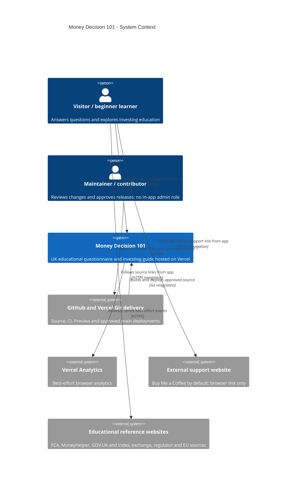
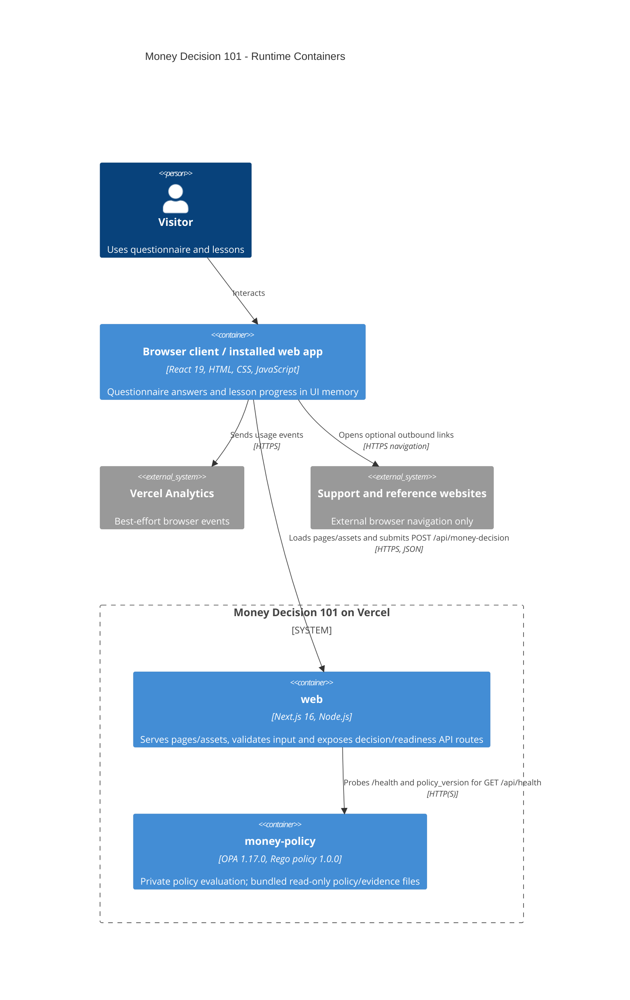

# C4 architecture diagrams

Source baseline: main `ed78847f5b617a4422e6aed0eea87c4a8eef7ad8`. These are source-derived C4 views, not evidence that a live cloud configuration was inspected. Diagrams use Mermaid's C4 syntax inside GitHub Markdown fences.

## Level 1 — System context

Visitors use the questionnaire and educational guide. The maintainer/contributor is an operational role, not an in-app administrator; there are no application accounts or authenticated roles.

Sources are navigational links, not APIs called by the decision engine. Google Fonts is a build-time dependency through next/font/google and omitted from the runtime context. Notion/v0 are planning/authoring tools outside the live system.

## Level 2 — Containers

In C4, a container means a runnable/deployable application or data store, not necessarily Docker. The browser client is shown separately from its Next.js host. Next.js pages and API handlers run in the same Vercel web service; only OPA uses the container runtime.

Vercel injects OPA_URL through a private service binding; the repository does not hardcode its hosted scheme/hostname. Locally it is plain HTTP at 127.0.0.1:8181. All public routing targets web; no public OPA rewrite exists. There is no SQL, GraphQL, gRPC or WebSocket integration in the reviewed decision flow, nor an application database/cache/object store/worker.

## Local equivalent

The CLI or optional Docker container runs OPA on 8181; npm runs Next.js on 3000 (or explicitly 3004). The same JSON REST policy contract is used locally. See [exact commands](../../CONTRIBUTING.md).
